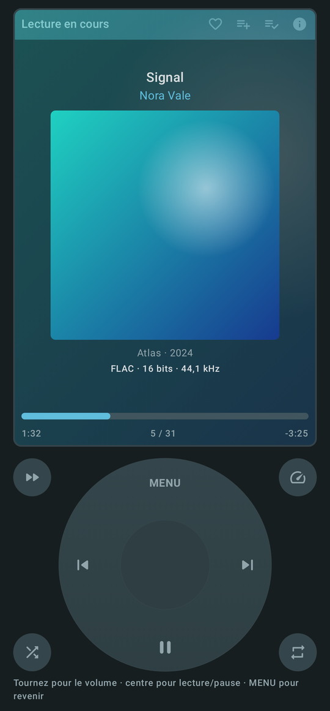
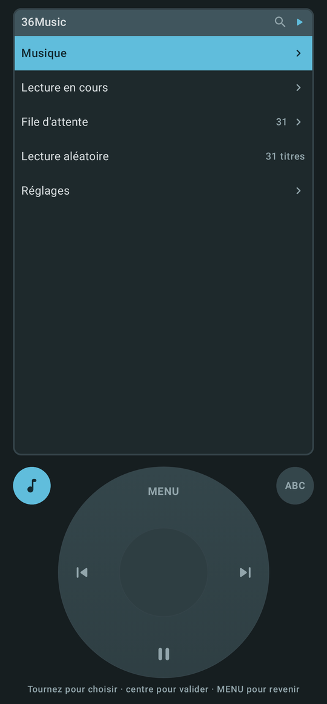
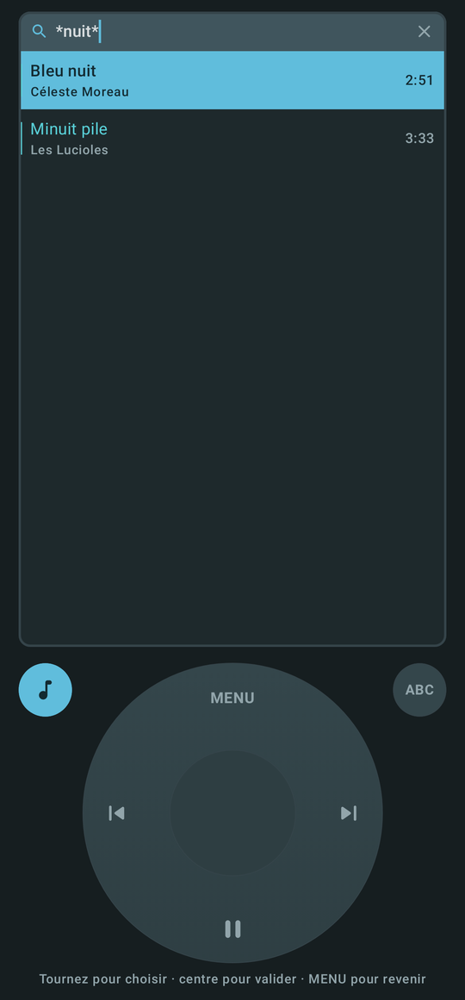
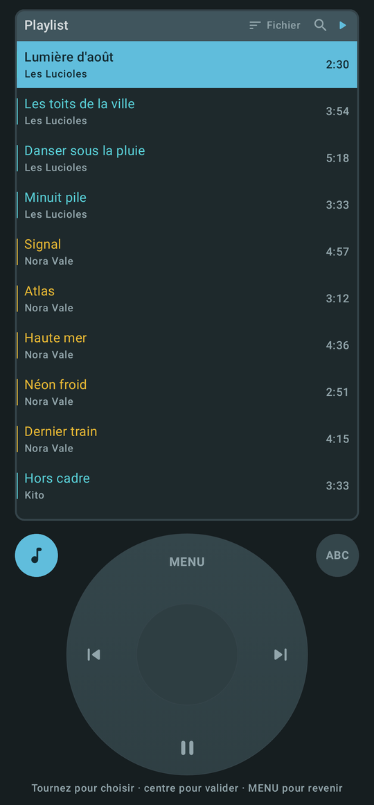
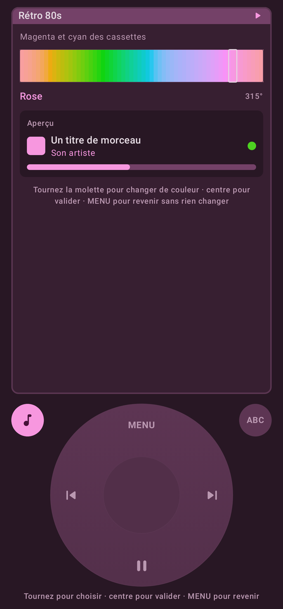
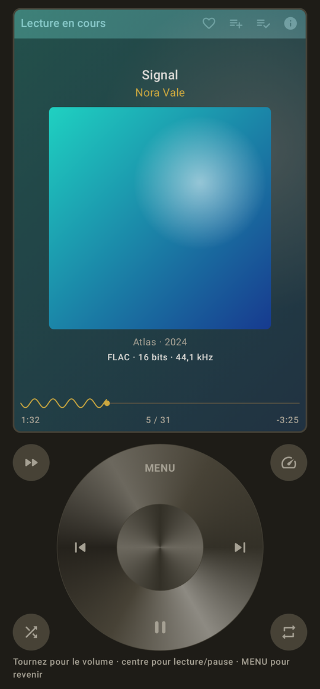
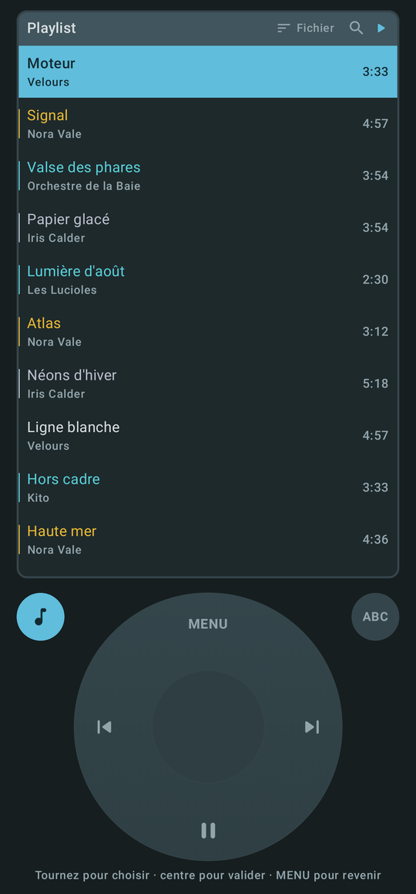
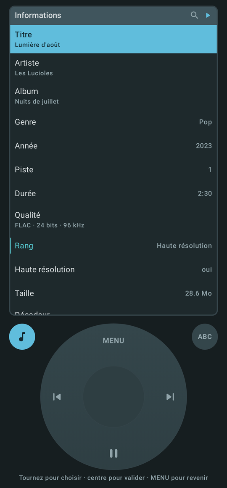
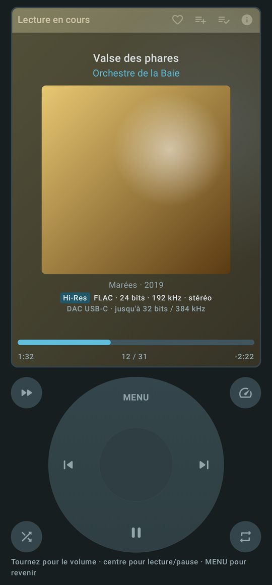

# 36Music

**Votre musique, à la molette.** Un lecteur de musique local pour Android, piloté par une molette
cliquable, à l'ancienne. Il lit les fichiers de vos propres dossiers — FLAC, ALAC, Hi-Res — sans compte, sans
réseau, sans permission de stockage, et sans rien altérer du son.

**[⬇ Télécharger l'APK](https://github.com/36txXnxTrGXgSH/36Music/releases/latest)** · **[Page de présentation](https://36txXnxTrGXgSH.github.io/36Music/)**

> 🔒 **Aucune connexion internet** — l'application n'a aucune permission réseau : Android lui
> interdit tout accès à internet. Rien n'est envoyé, rien n'est reçu.
>
> 🇫🇷 **Application en français uniquement** — menus, messages et documentation n'existent qu'en
> français.
>
> 🤖 **Entièrement réalisée avec Claude**, l'intelligence artificielle d'Anthropic : conception,
> code, tests, captures et documentation.

<table>
  <tr>
    <td align="center"><br><sub>Lecture en cours</sub></td>
    <td align="center"><br><sub>Tout à la molette</sub></td>
    <td align="center"><br><sub>Recherche à jokers</sub></td>
  </tr>
  <tr>
    <td align="center"><br><sub>Playlists synchronisées</sub></td>
    <td align="center"><br><sub>23 ambiances de couleurs</sub></td>
    <td align="center"><br><sub>Molette personnalisable</sub></td>
  </tr>
</table>

<sub>Les artistes, titres et pochettes des captures sont fictifs ; les captures sont dessinées
depuis le code (`CapturesPresentationTest`).</sub>

## En bref

- **La molette** : on tourne pour parcourir, on appuie au centre pour valider, MENU revient en
  arrière ; un appui long de 2 s ouvre les actions de la ligne. Tous les réglages s'y trouvent.
- **Le son tel qu'il a été enregistré** : sortie 32 bits flottante, aucun effet tant que
  l'égaliseur est éteint, DAC USB, décodeur ALAC intégré, qualité réellement décodée affichée.
- **Votre bibliothèque** : seulement les dossiers que vous désignez, analyse avec bilan, ordre
  alphabétique à la française.
- **Recherche à jokers** dans chaque menu : `emi*`, `*emi`, `rat*emi`.
- **Des playlists qui restent des fichiers** : vos `.m3u8` sont réécrits quand vous les modifiez,
  triés d'un appui, exportés ou partagés en M3U8, M3U ou XSPF.
- **Une molette à votre image** : 23 ambiances, 15 styles de roue, effets, 6 barres de
  progression, 3 configurations enregistrées.
- **Rien ne quitte le téléphone** : aucune connexion internet (aucune permission réseau),
  aucun compte, aucune publicité.

L'interface moderne (onglets, lecteur plein écran) reste disponible depuis *Réglages → Interface
moderne*.

---

*La suite de ce document décrit le fonctionnement interne, pour qui veut lire ou modifier le code.*

Lecteur de musique local pour Android, en Kotlin / Jetpack Compose (Material 3).
Aucun compte, aucun réseau, aucune publicité : il lit les fichiers **des dossiers que vous lui
désignez**, et rien d'autre.

- `applicationId` : `com.music36.app`
- minSdk 26 (Android 8) · targetSdk 35 · versionCode 44 · versionName 5.2

---

## Ce que fait l'application

### Premier démarrage : rien n'est analysé

36Music n'explore pas le téléphone tout seul. Au premier lancement, l'écran invite à **choisir un
dossier** ; on peut en ajouter, en retirer ou en changer à tout moment dans
*Paramètres → Dossiers de musique*.

Techniquement, tout passe par SAF (`ACTION_OPEN_DOCUMENT_TREE` + permission persistante), jamais
par `MediaStore`. Conséquences :

- **aucune permission de stockage** n'est demandée ;
- une carte SD ou un dossier `Documents/` fonctionnent aussi bien que `Music/` ;
- ce que l'utilisateur n'a pas désigné n'est jamais lu.

### Les sept onglets

`Sons` · `Playlists` · `Dossiers` · `Artistes` · `Albums` · `Genres` · `Favoris`

Chaque onglet porte les deux mêmes boutons, au même endroit :

- **Tout lire** — de la première à la dernière, dans l'ordre affiché ;
- **Aléatoire** — démarre sur un titre au hasard puis enchaîne sans jamais rejouer le même tant
  que la sélection n'est pas épuisée.

L'onglet *Dossiers* se parcourt en arbre ; « Tout lire » sur un dossier lit **aussi** ses
sous-dossiers. Les fichiers `.m3u` / `.m3u8` trouvés dans les dossiers analysés deviennent des
playlists de l'onglet *Playlists*.

### La barre du haut

**Recherche** (titre, artiste, album, genre, nom de fichier ; insensible à la casse et aux
accents, tous les mots doivent correspondre) et **Tri** : ordre alphabétique, date d'ajout, date
de création, plus artiste, album, durée et numéro de piste, croissant ou décroissant.

### Pendant la lecture

Pochette, titre, album, artiste, année, genre, **qualité sonore réellement décodée**, position,
lecture aléatoire, répétition (aucune / toute la sélection / le titre seul), précédent, lecture,
pause, suivant, **favori**, **ajout à une playlist**, file d'attente, minuteur de sommeil,
vitesse de lecture, égaliseur, fiche technique du fichier.

La lecture continue écran éteint et application fermée : elle vit dans un service, avec
notification, commandes de l'écran verrouillé, boutons du casque et Bluetooth.

### Paramètres

- **Dossiers** : ajouter, retirer, analyser les nouveautés, analyse complète.
- **Bibliothèque** : analyse au démarrage, ignorer les fichiers cachés, analyse approfondie de la
  qualité, durée minimale d'un titre, import des `.m3u` trouvés, import d'un `.m3u` choisi.
- **Lecture** : fondu au début et à la fin des morceaux (et à la pause), saut des silences,
  vitesse, conservation de la tonalité, reprise de la session au démarrage, mémoire de position
  des pistes de plus de dix minutes.
- **Qualité sonore** : sortie 32 bits flottante, déchargement audio (DSP), **routage vers le DAC
  USB**, égaliseur et effets.
- **Apparence** : thème (système / clair / sombre / **AMOLED**), **palette de couleurs**
  (Classique, Néon, Vif), couleurs dynamiques Material You, **style d'interface** (Moderne ou
  **Vue Rétro**), pochette floutée en fond du lecteur, affichage de la qualité dans les
  listes, écran maintenu allumé, onglet ouvert au démarrage.

---

## Apparence

**Vingt et une palettes en quatre familles** — Classique (Bleu nuit, Ardoise, Forêt, Bordeaux,
Sépia, Encre), Vif (Mandarine, Framboise, Citron vert, Turquoise, Cobalt, Prune), Néon (Cyan,
Magenta, Vert acide, Orange, Ultraviolet, Rouge laser) et Neutre (Blanc, Gris, Anthracite) —
chacune déclinée en clair et en sombre, avec ses propres couleurs de texte. *Paramètres →
Apparence → Palette de couleurs* les présente rangées par famille, chaque ligne dessinée avec ses
vraies couleurs.

La **vue molette a son propre choix de couleurs**, à trois étages : six catégories (Énergiques /
Lumineux, Sombres / Intenses, Doux / Apaisants, Élégants / Sérieux, Rétro / Nostalgiques, Nature /
Organique), vingt-trois ambiances à l'intérieur (Vif, Néon, Pop, Électrique, Sombre, Gothique,
Cyberpunk, Pastel, Doux, Aquarelle, Classique, Monochrome, Neutre, Minimaliste, Luxe, Vintage,
Rétro 70s, Rétro 80s, Art déco, Naturelles, Tropical, Océan, Forêt), puis une **barre de couleurs
que la molette parcourt** pour choisir la teinte sur tout le cercle chromatique. L'ambiance donne
le caractère — saturation, lumière de l'accent, écart entre les deux teintes — la barre donne la
couleur. Rien ne s'enregistre avant l'appui central : MENU laisse les couleurs d'avant.

Les couleurs dynamiques (Material You) l'emportent quand elles sont allumées ; choisir une palette
les éteint. Le mode **AMOLED** noircit les fonds de la palette sombre choisie, sans toucher aux
textes.

Les couleurs ne sont pas écrites à la main : chaque palette déclare deux teintes, et le reste est
calculé à des **luminances** qui tiennent les contrastes. `ContrasteTest` mesure les vingt et une
palettes dans les trois modes, et `ThemesCouleurTest` mesure les vingt-trois ambiances **sur tout
le tour du cercle** — la teinte n'étant plus écrite dans le code, il ne suffit plus d'en vérifier
quelques-unes — c'est ce qui manquait en 1.0, où le lecteur sortait en noir sur
noir dès qu'on quittait le thème clair. Le pourquoi et la règle sont dans
[docs/APPARENCE.md](docs/APPARENCE.md).

## La vue Rétro — l'interface principale

**C'est ce que l'application ouvre au démarrage.** Un écran unique surmontant une molette
cliquable : **on tourne** pour parcourir les menus, **on appuie au centre** pour valider, **MENU**
revient en arrière, les côtés changent de piste, le bas met en pause. Les listes ne répondent pas
au doigt : tout passe par la molette, avec un tic haptique à chaque cran.

**Tous les réglages se règlent ici**, sous *Réglages → Paramètres de l'application* : dossiers de
musique, bibliothèque, lecture, qualité sonore, égaliseur complet, apparence, export des
playlists. Les réglages continus — fondu, vitesse, durée minimale, bandes de l'égaliseur —
s'ouvrent sur un **cadran** que la molette déplace, et la valeur essayée ne s'enregistre qu'au
bouton central : MENU rend celle d'avant.

*Réglages → Interface moderne* ouvre l'autre interface — onglets, listes et lecteur plein écran.
Elle n'a **plus d'écran de réglages** : son menu ⋮ → *Paramètres* ramène à la molette et y ouvre
directement les réglages, avec en tête *Revenir à l'interface moderne* ; MENU remonte à
*Réglages* puis à l'accueil de la molette.

**Configurations enregistrées** (*Réglages* ou *Réglages de la vue Rétro*) : trois emplacements pour
mettre de côté toute l'apparence de la molette et la rappeler d'un geste. Un emplacement vide
s'enregistre d'un appui ; un emplacement rempli se rappelle, se remplace par l'apparence
actuelle ou se supprime, ces deux derniers après confirmation. Deux écrans pour les mêmes champs en faisaient un de trop, et celui-là
obligeait à quitter la roue pour y revenir.

L'écran « Lecture en cours » porte six commandes tactiles : **favori** et **ajout à une playlist**
dans sa barre de titre, et quatre boutons dans les coins de la molette — **avance/recul** et
**vitesse**, qui changent ce que commande la rotation (sinon elle règle le volume), **aléatoire**
et **répétition**.

L'écran de lecture affiche **titre, artiste, album, année, qualité décodée** et la sortie
matérielle branchée, autour d'une grande pochette. Sa barre de titre porte **favori**, **ajout à
une playlist** et un bouton **information** : lire ensuite, ajouter à la file, aller à l'album ou
à l'artiste, et la fiche technique du fichier.

*Musique → **Titres les plus écoutés*** classe les cent titres les plus joués, avec leur nombre
d'écoutes — les compteurs sont tenus par le service de lecture depuis la première version, et
vivent dans la base.

*Musique → **Cover Flow*** fait défiler les pochettes en carrousel incliné ; le bouton central
ouvre les titres de l'album en surimpression, sans quitter le carrousel. Et dans les longues
listes, un défilement rapide affiche la **grande initiale** au centre de l'écran, comme sur
l'appareil d'origine — toutes les listes de cette vue sont rangées par ordre alphabétique, sans
quoi le repère ne voudrait rien dire. Détails dans [docs/RETRO.md](docs/RETRO.md).

Pour revenir à l'interface classique : molette → Réglages → Interface moderne.

---

## Qualité sonore

<p align="center">
  
  
  
</p>

**La couleur des titres** dit la qualité du fichier, dans toutes les listes de la vue Rétro :

| Couleur | Rang | Ce que cela veut dire |
| --- | --- | --- |
| cyan | **Haute résolution** | sans perte au-delà du CD : plus de 16 bits ou plus de 48 kHz (badge `Hi-Res` à la lecture) |
| or | **Sans perte** | FLAC, ALAC, WAV, AIFF, APE, WavPack, DSD en qualité CD |
| gris bleuté | **Compressé** | AAC/M4A, Opus, Ogg Vorbis : avec perte, mais de génération récente |
| couleur normale | **Ordinaire** | MP3, WMA et le reste — un MP3 320 kbit/s reste ordinaire |

Sous la pochette, la **qualité réellement décodée** (`FLAC · 24 bits · 192 kHz · stéréo`) et la
**sortie matérielle** avec ses capacités (`DAC USB-C · jusqu'à 32 bits / 384 kHz`) ; le bouton ⓘ
ouvre la fiche du fichier (rang, décodeur employé). Tout le détail, limites comprises, sur la
[page de présentation](https://36txXnxTrGXgSH.github.io/36Music/#qualite).

Le point de départ : **ne rien abîmer**.

- Sortie **32 bits flottante** activée par défaut (`DefaultRenderersFactory.setEnableAudioFloatOutput`) :
  un fichier 24 ou 32 bits n'est pas tronqué à 16 bits.
- **Aucun effet audio n'est instancié tant que l'égaliseur est éteint** : le flux part au décodeur
  sans retouche.
- Changement de vitesse confié au matériel (`setEnableAudioTrackPlaybackParams`), sans
  rééchantillonnage logiciel supplémentaire.
- **Déchargement (offload)** proposé en option — économe en batterie, mais incompatible avec les
  effets : l'égaliseur, quand il est allumé, l'emporte automatiquement.
- L'étiquette de qualité affichée dans le lecteur vient du **format réellement décodé**
  (`AnalyticsListener.onAudioInputFormatChanged`), pas des étiquettes du fichier. Le badge
  **Hi-Res** n'apparaît que sur un format sans perte au-delà de 16 bits / 48 kHz.
- Aucune normalisation, aucun ReplayGain, aucun limiteur : le volume du lecteur reste à 1,0.

### DAC USB

Un adaptateur jack 3,5 mm → USB-C qui embarque son propre DAC est **détecté et affiché** (nom,
fréquences et profondeurs acceptées), et la lecture lui est **routée explicitement**
(`setPreferredAudioDevice`) — utile quand une enceinte Bluetooth reste appairée et capterait le
son. Réglage *Qualité sonore → Router vers le DAC USB*, allumé par défaut.

⚠️ **Ce qu'aucune application ne peut promettre** : au-delà d'`AudioTrack`, le flux traverse le
mixeur d'Android, qui peut rééchantillonner vers la fréquence de la sortie matérielle. 36Music
n'ajoute aucune perte, mais le « bit-perfect » garanti demanderait un pilote USB propriétaire
court-circuitant la pile audio du système. Le détail est dans
[docs/SORTIE-AUDIO.md](docs/SORTIE-AUDIO.md).

### Formats

Lus : **MP3, AAC (.m4a, .m4b, .aac), MP4, FLAC, **ALAC** (décodeur embarqué), WAV, AIFF, Ogg Vorbis, Opus, Matroska
(MKA/MKV), WebM, AC3/E-AC3, AMR, MIDI**, et tout ce que le téléphone sait décoder — le repli sur
le décodeur logiciel est activé, et chaque piste annonce le type de son conteneur pour aiguiller
l'extracteur.

Un fichier dont les **étiquettes** sont illisibles entre quand même dans la bibliothèque, nommé
d'après son fichier : lire les métadonnées et décoder l'audio sont deux moteurs distincts, et le
premier est le plus capricieux. Le nombre de ces fichiers est annoncé après l'analyse.

**L'ALAC (Apple Lossless, souvent en `.m4a`) est décodé par 36Music lui-même.** Beaucoup
d'appareils Android n'ont aucun décodeur `audio/alac` ; le morceau se lançait alors sans qu'un son
sorte, ExoPlayer ne signalant pas ce cas comme une erreur. L'application **embarque son propre
décodeur ALAC** (`lecture/alac/`, en Kotlin) : ces fichiers se lisent partout, quel que soit le
téléphone. La fiche du fichier indique quel décodeur travaille — `36music.alac` quand c'est le
nôtre. Détails et pièges dans [docs/SORTIE-AUDIO.md](docs/SORTIE-AUDIO.md).

⚠️ **WMA et WMV ne sont décodés par aucun appareil Android** : ces fichiers apparaissent bien dans
la bibliothèque (l'analyse les reconnaît), mais la lecture échoue, et 36Music le dit franchement
au lieu de rester muet (« Format non pris en charge par Android »). Il n'existe pas de décodeur
Windows Media redistribuable côté Android ; la seule solution est de convertir ces fichiers, par
exemple en FLAC.

---

## Compiler

Le poste doit avoir le SDK Android et un **JDK 21** (Gradle 8.11.1 / AGP 8.7.2 refusent le JDK 25
du JBR récent d'Android Studio) :

```bash
export JAVA_HOME=/chemin/vers/un/jdk-21
./gradlew assembleDebug        # app/build/outputs/apk/debug/app-debug.apk
./gradlew testDebugUnitTest    # 252 tests
./gradlew assembleRelease      # APK optimisé par R8
```

La version *release* se signe avec une clé décrite dans un `keystore.properties` à la racine
(`storeFile`, `storePassword`, `keyAlias`, `keyPassword`) ; ce fichier et la clé ne sont **jamais**
versionnés. Sans lui, `assembleRelease` produit un APK non signé.

`local.properties` pointe le SDK ; **les antislashs y sont à proscrire**, écrire le chemin avec des
barres obliques.

### Signer la release

Sans clé, `assembleRelease` produit un APK **non signé**, qui ne s'installe pas. Pour signer,
créer la clé puis la décrire à la racine du projet :

```bash
keytool -genkeypair -v -keystore keystore/36music-release.jks -alias 36music \
  -keyalg RSA -keysize 2048 -validity 10000
```

`keystore.properties` (jamais versionné, à sauvegarder ailleurs — sans lui, plus aucune mise à
jour ne s'installera par-dessus l'APK publié) :

```properties
storeFile=keystore/36music-release.jks
storePassword=…
keyAlias=36music
keyPassword=…
```

---

## Organisation du code

```
app/src/main/java/com/music36/app/
├── Music36App.kt          conteneur unique : base, réglages, dépôt, égaliseur, lecteur
├── MainActivity.kt        thème, écran racine, ouverture d'un fichier depuis un explorateur
├── data/
│   ├── Modeles.kt         Piste, Playlist… + tri, regroupements et formats (fonctions pures)
│   ├── Base.kt            Room : pistes, racines, favoris, playlists, statistiques
│   ├── Analyseur.kt       parcours SAF, métadonnées, pochettes, import .m3u
│   ├── Depot.kt           les flux que lit toute l'interface
│   ├── Reglages.kt        DataStore
│   └── M3u.kt             lecture et écriture des playlists .m3u
├── lecture/
│   ├── ServiceLecture.kt  MediaSessionService + ExoPlayer (notification, casque, écran verrouillé)
│   ├── Lecteur.kt         MediaController : ce que commande l'interface
│   ├── Egaliseur.kt       Equalizer, BassBoost, Virtualizer, LoudnessEnhancer
│   └── SortieAudio.kt     la qualité réellement décodée
└── ui/                    Compose : accueil, détails, lecteur, recherche, file, égaliseur, réglages
    ├── Theme.kt           thèmes, palettes, mode AMOLED
    └── retro/              interface molette : NiveauRetro (pile de menus), EntreesRetro
                           (contenu + souvenir des tris), ListeRetro et LectureRetro (rendu),
                           Molette (gestes), TeinteRetro (barre de couleurs),
                           EcranRetro (assemblage), CoverFlow
```

Cinq notes détaillent les parties qui se paient cher si on les redécouvre :
[docs/ANALYSE.md](docs/ANALYSE.md), [docs/LECTURE.md](docs/LECTURE.md),
[docs/SORTIE-AUDIO.md](docs/SORTIE-AUDIO.md), [docs/APPARENCE.md](docs/APPARENCE.md) et
[docs/RETRO.md](docs/RETRO.md).

## Tests

`./gradlew testDebugUnitTest` — 252 tests, dont :

- vingt et un qui **composent réellement l'interface** sous Robolectric (premier démarrage, sept
  onglets, paramètres, écran des palettes) et **pilotent la molette** (rotation mesurée en crans,
  appui central, retour MENU, validation de la bonne entrée, boutons de l'écran de lecture,
  descente jusqu'à Cover Flow et ouverture d'un album) ;
- ceux qui **mesurent le contraste** de chaque palette et de chaque ambiance en clair, sombre et
  AMOLED — le seul filet contre le défaut de lisibilité de la 1.0, qu'aucun test d'affichage
  n'aurait attrapé.

Conventions 36 habituelles : interface **et** commentaires en français, `versionCode` **et**
`versionName` incrémentés à chaque livraison.

### Le rituel de livraison

Toute version ajoute son entrée **en tête** de `data/Nouveautes.kt` — c'est ce que l'application
affiche au premier démarrage qui suit la mise à jour. Ce n'est pas une consigne qu'on peut
oublier : `NouveautesTest` compare la tête du journal à `BuildConfig.VERSION_CODE` et
`VERSION_NAME`, et **les tests échouent** si la version livrée ne se décrit pas.

Les lignes s'adressent à quelqu'un qui se sert de l'application : ce qui change à l'usage, pas le
nom des classes touchées. Trois genres — `AJOUT`, `CORRECTION`, `AMELIORATION` — qui donnent sa
pastille à chaque ligne.

La fenêtre ne s'ouvre jamais sur une installation neuve : `firstInstallTime` et `lastUpdateTime`
y sont égaux, et dérouler un journal des versions à quelqu'un qui découvre l'application ne lui
apprendrait rien. On la retrouve à tout moment dans **Réglages → À propos → Nouveautés**.
